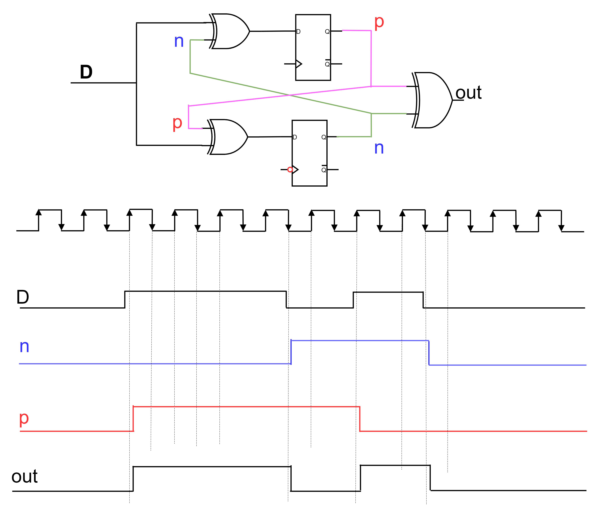
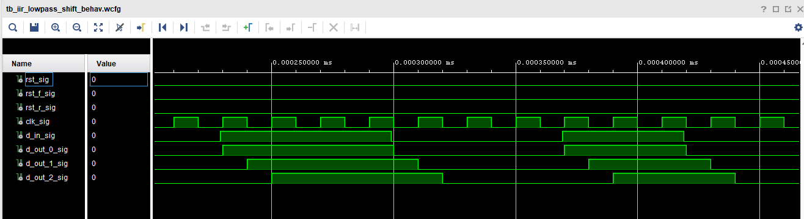
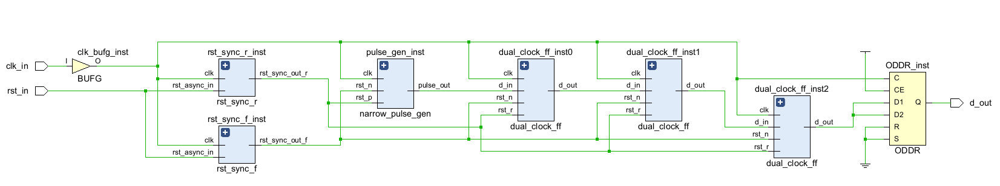
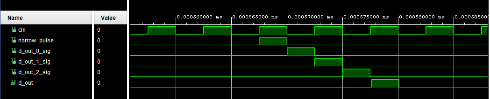
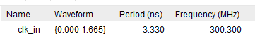
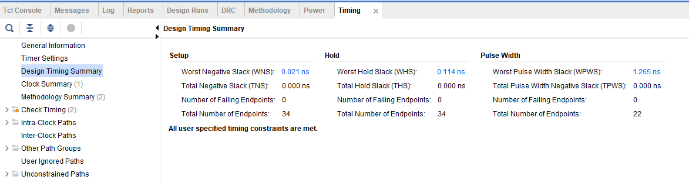

# VHDL / Verilog Vivado Implementation of Pseudo Dual Edge Triggered Flip Flop. 

### <mark>***A 1.65 ns-wide pulse was generated and transmitted.***

---

Circuit's operation: 

The circuit is defined in https://patents.google.com/patent/US5327019A/en

Also see explanation in 
* https://vlsi-soc.blogspot.com/2013/06/dual-edge-triggered-flip-flop.html
*    https://www.youtube.com/watch?v=8FgTD1q88_E

The results of simulation for 3 stages of dual edge flip flop :

We can observe that the signal is indeed sampled on both the rising and falling edges of the clock.

---

To evaluate the dual edge triggered FF usage I performed implementation (including Place and Rout) of simple design that generates a short pulse between rising and falling clock edges, passes this pulse through 3 dual edge triggered FFs, inserting delay of half clock every time, and output the pulse through ODDR block (that inserts additional half clock delay).

The RTL of design: 

Simulation of the design : 

After P&R the desing pass without timing errors with input clock frequency of 300MHz.

It is worth noting that this design generated a narrow **1.65 ns** pulse inside the FPGA and transmitted it externally while maintaining precise timing accuracy.

